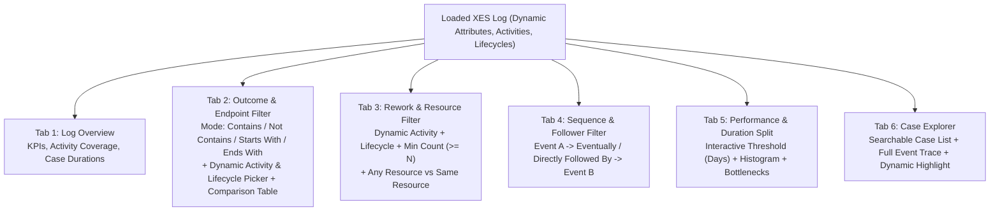

# Implementation Plan: User-Driven Process Mining Explorer UX Refactor

## Goal Description

Refactor the desktop application (`bpic17_app`) from a static, exercise-labeled dashboard into a **clean, general-purpose Process Mining Explorer** (inspired by Disco / Celonis):

1. **Zero "FR / Exercise / Reference" Slop in UI**: Remove all mentions of `F01–F07`, `Exercise 11.7`, `Exercise 11.15`, `Exercise 11.18`, `Exercise 11.22`, `Example 11.10`, and hardcoded `Ref: ...` strings from tab titles, banners, KPI cards, and tables.
2. **Interactive, User-Driven Exploration**: Instead of locking tabs to specific homework questions, organize the UI by **core process mining capabilities** with interactive filter builders populated dynamically from the loaded `.xes` log so users discover answers themselves by selecting activities, lifecycles, occurrence counts, resource rules, and sequence relations.

---

## Proposed UX & Architecture Changes



---

### 1. Core Parameterized Analysis Functions (`bpic17_app/analyzer.py`)

#### [MODIFY] [analyzer.py](file:///A:/%23%23Edge%20Downloads/%23%23New%20folder/5_DATMIN/TugasKelompok2_PM4PY/PM4PY_WORKSPACE/tugas-kelompok-pm4py/bpic17_app/analyzer.py)
Add general, user-parameterized filter functions alongside existing helpers:

- **`filter_by_activity_rule(df, case_stats, activity, mode, lifecycle=None)`**:
  - `mode`: `"contains"` (trace contains $\ge 1$), `"not_contains"`, `"starts_with"` (first event in trace), or `"ends_with"` (last event in trace).
  - `lifecycle`: `"All"` or a specific `lifecycle:transition` value.
  - Returns matching case count, `%` of total cases (with denominator), mean/median/min/max cycle time (from unfiltered `case_stats`), and the filtered `case_stats` DataFrame.
- **`filter_rework_and_resource(df, case_stats, activity, lifecycle="complete", min_count=2, same_resource=False, exclude_empty_resource=True)`**:
  - Dynamically filters any selected `activity` (or all activities), any `lifecycle` (`"complete"`, `"schedule"`, `"All"`, etc.), any `min_count >= 1`, and toggles between **Case-level repetition (`Any Resource`)** and **Identical Resource repetition (`Same Resource`)**.
  - Returns matching cases count, denominator, `%`, qualifying cases table, and supporting event evidence table.
- **`filter_sequence_relation(df, case_stats, first_activity, second_activity, relation="eventually_follows", lifecycle="All")`**:
  - Supports both `"eventually_follows"` ($i < j$ in trace) and `"directly_follows"` ($j = i + 1$ in trace) for any pair of activities `(Event A, Event B)` chosen by the user.
  - Returns `Yes/No`, matching case count, total case denominator, `%`, and witness event pairs table.

---

### 2. Interactive Desktop GUI (`bpic17_app/gui.py`)

#### [MODIFY] [gui.py](file:///A:/%23%23Edge%20Downloads/%23%23New%20folder/5_DATMIN/TugasKelompok2_PM4PY/PM4PY_WORKSPACE/tugas-kelompok-pm4py/bpic17_app/gui.py)
Rename and redesign the 6 tabs into clean, capability-focused workspaces with zero homework/FR jargon:

1. **`Overview`**
   - Displays dataset metadata (filename, total cases, total events, attributes, lifecycle states).
   - KPI Cards: **Total Cases**, **Total Events**, **Mean Cycle Time**, **Median / Max Cycle Time**, **Log Time Span**.
   - **Activity Summary Table** & **Case Duration Table**.
2. **`Activity & Endpoint Filter`**
   - **Interactive Filter Controls**:
     - *Rule Type*: `Contains Activity (≥ 1)`, `Ends With Activity (Last Event)`, `Starts With Activity (First Event)`, `Does Not Contain Activity`.
     - *Activity*: Dropdown populated with all unique `concept:name` values in the log.
     - *Lifecycle*: `All Transitions` or specific `lifecycle:transition`.
     - Buttons: **Apply Filter**, **Pin Current Result to Comparison Table**, **Clear Comparison**.
   - **KPI Cards**: Matching Cases, `%` of Total Cases, Mean Cycle Time (Days), Median / Max Cycle Time.
   - **Pinned Comparison Table** (top) & **Matching Cases Table** (bottom, with **Inspect Case in Explorer** & **Export CSV**).
3. **`Rework & Resource Filter`**
   - **Interactive Filter Controls**:
     - *Activity*: Dropdown of all activities in the log.
     - *Lifecycle Transition*: Dropdown (`complete`, `schedule`, `start`, `ate_abort`, `All Transitions`).
     - *Min Occurrences (`≥ N`)*: Spinbox (`1..100`, default `2`).
     - *Resource Scope*: `Any Resource (Case Rework)` vs `Same Resource (Identical Resource in Case)` + checkbox `Exclude empty/UNKNOWN resource`.
   - **KPI Cards**: Matching Cases, `%` of Log (with denominator), Total Matching Events, Distinct Resources.
   - **Qualifying Cases Table** & **Event Evidence Table** (with **Inspect Case in Explorer** & **Export CSV**).
4. **`Sequence & Follower Filter`**
   - **Interactive Filter Controls**:
     - *First Activity (`Event A`)*: Dropdown of all activities + optional button **Swap A ↔ B**.
     - *Relation*: `Eventually Followed By (A ... → B)` or `Directly Followed By (A → B)`.
     - *Second Activity (`Event B`)*: Dropdown of all activities.
   - **KPI Cards**: Pattern Found (`Yes`/`No`), Matching Cases, Total Cases (Denominator), Percentage (`%`).
   - **Witness Event Pairs Table** (`case_id`, `first_step`, `first_time`, `second_step`, `second_time`, `events_between`, `end_activity`, `duration_days`).
5. **`Duration & Bottlenecks`**
   - Interactive **Slow Case Threshold (Days)** spinbox + **Apply Threshold** button.
   - KPI Cards: Fast Cases (`< Threshold`), Slow Cases (`≥ Threshold`), Max Duration, Slow Cases Ending Activity breakdown.
   - **Matplotlib Duration Histogram** + **Bottleneck Activity Bar Chart** + **Activity Comparison & Slow Cases Tables**.
6. **`Case Explorer`**
   - Left: Searchable Case Table.
   - Right: Full Chronological Event Trace + **Highlight Activity** dropdown/search so the user can highlight any activity on the fly.

---

### 3. Documentation & Traceability Guide

#### [MODIFY] [traceability_matrix.md](file:///A:/%23%23Edge%20Downloads/%23%23New%20folder/5_DATMIN/TugasKelompok2_PM4PY/PM4PY_WORKSPACE/tugas-kelompok-pm4py/ignore_TUGAS-PM4PY/traceability_matrix.md)
- Update the guide to show how each general tab/filter maps to the underlying code AND what filter selections a user makes in the UI to explore any question in `BPIC-2017.pdf`.

---

## Verification Plan

### Automated Tests
1. Run unit tests (`tests_app/test_analyzer.py`) verifying both the parameterized filter functions (`filter_by_activity_rule`, `filter_rework_and_resource`, `filter_sequence_relation`) and the 8 synthetic edge cases:
   ```powershell
   .venv\Scripts\python.exe -m unittest discover -s tests_app -v
   ```
2. Run headless GUI verification & screenshot capture on `BPI Challenge 2017.xes` to confirm zero FR/Exercise labels appear in the UI and all interactive filters work smoothly.
