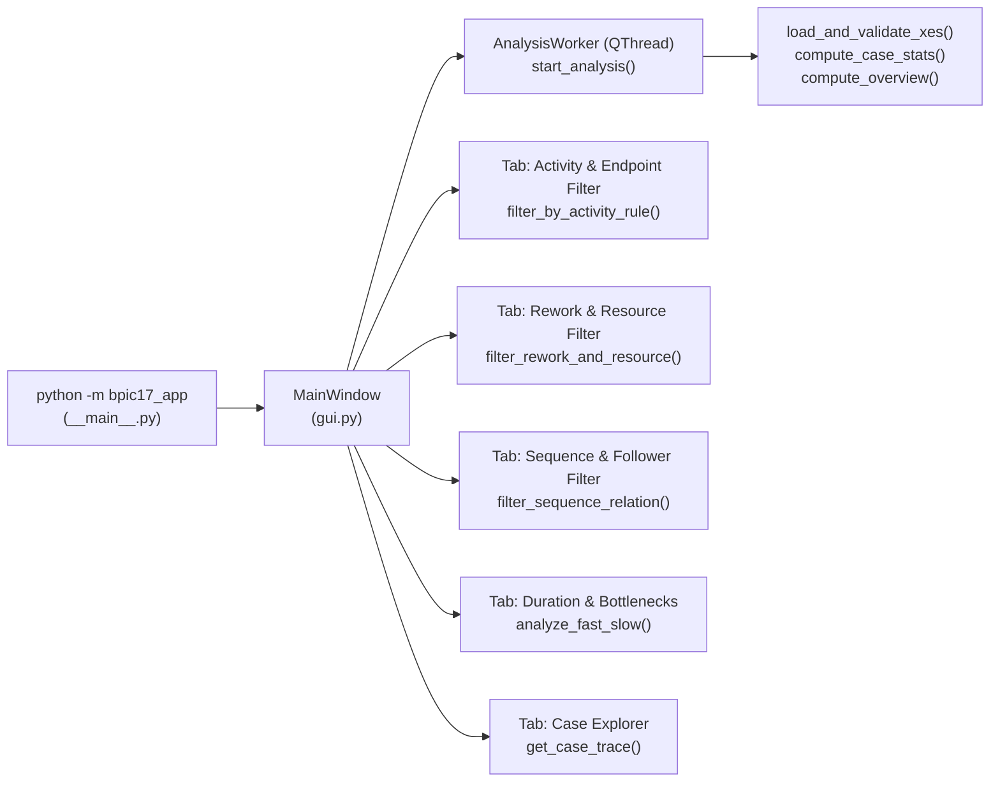

# Traceability & User Exploration Guide (`bpic17_app`)

Aplikasi disusun sebagai **Process Mining & Event Log Explorer** generik (tanpa label `FR` atau nomor latihan di antarmuka) agar pengguna dapat mengeksplorasi event log `.xes` secara bebas layaknya menggunakan alat analitik proses (seperti Disco / Celonis).

Dokumen ini memetakan:
1. **Setiap Tab & Fitur Interaktif** ke lokasi kode di [analyzer.py](file:///A:/%23%23Edge%20Downloads/%23%23New%20folder/5_DATMIN/TugasKelompok2_PM4PY/PM4PY_WORKSPACE/tugas-kelompok-pm4py/bpic17_app/analyzer.py), [gui.py](file:///A:/%23%23Edge%20Downloads/%23%23New%20folder/5_DATMIN/TugasKelompok2_PM4PY/PM4PY_WORKSPACE/tugas-kelompok-pm4py/bpic17_app/gui.py), dan [test_analyzer.py](file:///A:/%23%23Edge%20Downloads/%23%23New%20folder/5_DATMIN/TugasKelompok2_PM4PY/PM4PY_WORKSPACE/tugas-kelompok-pm4py/tests_app/test_analyzer.py).
2. **Cara Mengeksplorasi Jawaban (`BPIC-2017.pdf`) Lewat Filter Interaktif di Aplikasi**.

---

## 1. Arsitektur & Alur Pemanggilan (`Where to Look`)

| Tab / Fitur di Aplikasi | Apa yang Dilakukan Fitur Ini | Backend Engine (`analyzer.py`) | GUI Handler (`gui.py`) | Unit Test (`test_analyzer.py`) |
| :--- | :--- | :--- | :--- | :--- |
| **Top Bar & XES Loader** | Membuka file `.xes`, menjalankan parsing di background thread (`QThread`), validasi atribut & lifecycle, tombol *Reload / Reset*, *Export Summary CSV*, & *About* | [prepare_dataframe](file:///A:/%23%23Edge%20Downloads/%23%23New%20folder/5_DATMIN/TugasKelompok2_PM4PY/PM4PY_WORKSPACE/tugas-kelompok-pm4py/bpic17_app/analyzer.py#L54-L85), [load_and_validate_xes](file:///A:/%23%23Edge%20Downloads/%23%23New%20folder/5_DATMIN/TugasKelompok2_PM4PY/PM4PY_WORKSPACE/tugas-kelompok-pm4py/bpic17_app/analyzer.py#L88-L129), [run_full_analysis](file:///A:/%23%23Edge%20Downloads/%23%23New%20folder/5_DATMIN/TugasKelompok2_PM4PY/PM4PY_WORKSPACE/tugas-kelompok-pm4py/bpic17_app/analyzer.py#L970-L1006) | [prompt_open_xes](file:///A:/%23%23Edge%20Downloads/%23%23New%20folder/5_DATMIN/TugasKelompok2_PM4PY/PM4PY_WORKSPACE/tugas-kelompok-pm4py/bpic17_app/gui.py#L957-L968), [start_analysis](file:///A:/%23%23Edge%20Downloads/%23%23New%20folder/5_DATMIN/TugasKelompok2_PM4PY/PM4PY_WORKSPACE/tugas-kelompok-pm4py/bpic17_app/gui.py#L974-L989), [AnalysisWorker](file:///A:/%23%23Edge%20Downloads/%23%23New%20folder/5_DATMIN/TugasKelompok2_PM4PY/PM4PY_WORKSPACE/tugas-kelompok-pm4py/bpic17_app/gui.py#L272-L291) | [test_fast_slow_and_exports_and_trace](file:///A:/%23%23Edge%20Downloads/%23%23New%20folder/5_DATMIN/TugasKelompok2_PM4PY/PM4PY_WORKSPACE/tugas-kelompok-pm4py/tests_app/test_analyzer.py#L260-L341) |
| **Tab 1: `Log Overview`** | Menampilkan metadata log, KPI Total Cases, Total Events, Mean/Median/Max Cycle Time, rentang waktu, tabel frekuensi aktivitas, dan tabel durasi seluruh case | [compute_case_stats](file:///A:/%23%23Edge%20Downloads/%23%23New%20folder/5_DATMIN/TugasKelompok2_PM4PY/PM4PY_WORKSPACE/tugas-kelompok-pm4py/bpic17_app/analyzer.py#L132-L155), [compute_overview](file:///A:/%23%23Edge%20Downloads/%23%23New%20folder/5_DATMIN/TugasKelompok2_PM4PY/PM4PY_WORKSPACE/tugas-kelompok-pm4py/bpic17_app/analyzer.py#L158-L211) | [_build_tab_overview](file:///A:/%23%23Edge%20Downloads/%23%23New%20folder/5_DATMIN/TugasKelompok2_PM4PY/PM4PY_WORKSPACE/tugas-kelompok-pm4py/bpic17_app/gui.py#L552-L594), [populate_from_bundle](file:///A:/%23%23Edge%20Downloads/%23%23New%20folder/5_DATMIN/TugasKelompok2_PM4PY/PM4PY_WORKSPACE/tugas-kelompok-pm4py/bpic17_app/gui.py#L1077-L1104) | [test_11_7_c_duplicate_accepted_counted_once](file:///A:/%23%23Edge%20Downloads/%23%23New%20folder/5_DATMIN/TugasKelompok2_PM4PY/PM4PY_WORKSPACE/tugas-kelompok-pm4py/tests_app/test_analyzer.py#L38-L64) |
| **Tab 2: `Activity & Endpoint Filter`** | Filter case interaktif berdasarkan aturan *Contains*, *Ends With*, *Starts With*, atau *Does Not Contain* untuk aktivitas & lifecycle apa pun, dilengkapi **Filter Comparison Table** (*Pin to Comparison*) | [filter_by_activity_rule](file:///A:/%23%23Edge%20Downloads/%23%23New%20folder/5_DATMIN/TugasKelompok2_PM4PY/PM4PY_WORKSPACE/tugas-kelompok-pm4py/bpic17_app/analyzer.py#L224-L348), [analyze_11_7](file:///A:/%23%23Edge%20Downloads/%23%23New%20folder/5_DATMIN/TugasKelompok2_PM4PY/PM4PY_WORKSPACE/tugas-kelompok-pm4py/bpic17_app/analyzer.py#L679-L761) | [_build_tab_outcome_filter](file:///A:/%23%23Edge%20Downloads/%23%23New%20folder/5_DATMIN/TugasKelompok2_PM4PY/PM4PY_WORKSPACE/tugas-kelompok-pm4py/bpic17_app/gui.py#L599-L672), [apply_outcome_filter](file:///A:/%23%23Edge%20Downloads/%23%23New%20folder/5_DATMIN/TugasKelompok2_PM4PY/PM4PY_WORKSPACE/tugas-kelompok-pm4py/bpic17_app/gui.py#L1137-L1168), [pin_current_outcome_filter](file:///A:/%23%23Edge%20Downloads/%23%23New%20folder/5_DATMIN/TugasKelompok2_PM4PY/PM4PY_WORKSPACE/tugas-kelompok-pm4py/bpic17_app/gui.py#L1170-L1187) | [test_11_7_c_duplicate_accepted_counted_once](file:///A:/%23%23Edge%20Downloads/%23%23New%20folder/5_DATMIN/TugasKelompok2_PM4PY/PM4PY_WORKSPACE/tugas-kelompok-pm4py/tests_app/test_analyzer.py#L38-L64), [test_11_7_e_o_cancelled_in_middle_not_canceled](file:///A:/%23%23Edge%20Downloads/%23%23New%20folder/5_DATMIN/TugasKelompok2_PM4PY/PM4PY_WORKSPACE/tugas-kelompok-pm4py/tests_app/test_analyzer.py#L66-L101), [test_11_7_c_and_d_not_mutually_exclusive](file:///A:/%23%23Edge%20Downloads/%23%23New%20folder/5_DATMIN/TugasKelompok2_PM4PY/PM4PY_WORKSPACE/tugas-kelompok-pm4py/tests_app/test_analyzer.py#L103-L123) |
| **Tab 3: `Rework & Resource Filter`** | Filter pengulangan aktivitas ($\ge N$ kali) dengan pilihan transisi lifecycle (`complete`, `schedule`, `All`, dll.) dan cakupan resource (*Any Resource* vs *Same Resource* + opsi kecualikan resource kosong/`UNKNOWN`) | [filter_rework_and_resource](file:///A:/%23%23Edge%20Downloads/%23%23New%20folder/5_DATMIN/TugasKelompok2_PM4PY/PM4PY_WORKSPACE/tugas-kelompok-pm4py/bpic17_app/analyzer.py#L351-L514), [act_res_res_invalid](file:///A:/%23%23Edge%20Downloads/%23%23New%20folder/5_DATMIN/TugasKelompok2_PM4PY/PM4PY_WORKSPACE/tugas-kelompok-pm4py/bpic17_app/analyzer.py#L214-L216) | [_build_tab_rework_filter](file:///A:/%23%23Edge%20Downloads/%23%23New%20folder/5_DATMIN/TugasKelompok2_PM4PY/PM4PY_WORKSPACE/tugas-kelompok-pm4py/bpic17_app/gui.py#L677-L750), [apply_rework_filter](file:///A:/%23%23Edge%20Downloads/%23%23New%20folder/5_DATMIN/TugasKelompok2_PM4PY/PM4PY_WORKSPACE/tugas-kelompok-pm4py/bpic17_app/gui.py#L1199-L1255) | [test_11_15_scheduled_twice_completed_once_rejected](file:///A:/%23%23Edge%20Downloads/%23%23New%20folder/5_DATMIN/TugasKelompok2_PM4PY/PM4PY_WORKSPACE/tugas-kelompok-pm4py/tests_app/test_analyzer.py#L125-L155), [test_11_15_and_11_18_different_vs_same_and_empty_resources](file:///A:/%23%23Edge%20Downloads/%23%23New%20folder/5_DATMIN/TugasKelompok2_PM4PY/PM4PY_WORKSPACE/tugas-kelompok-pm4py/tests_app/test_analyzer.py#L157-L217) |
| **Tab 4: `Sequence & Follower Filter`** | Filter urutan pasangan aktivitas (`Event A` diikuti `Event B`) dengan mode *Eventually Followed By ($i < j$)* atau *Directly Followed By ($j = i + 1$)*, tombol *Swap A ↔ B*, dan tabel pasangan event bukti | [filter_sequence_relation](file:///A:/%23%23Edge%20Downloads/%23%23New%20folder/5_DATMIN/TugasKelompok2_PM4PY/PM4PY_WORKSPACE/tugas-kelompok-pm4py/bpic17_app/analyzer.py#L517-L672) | [_build_tab_sequence_filter](file:///A:/%23%23Edge%20Downloads/%23%23New%20folder/5_DATMIN/TugasKelompok2_PM4PY/PM4PY_WORKSPACE/tugas-kelompok-pm4py/bpic17_app/gui.py#L755-L822), [apply_sequence_filter](file:///A:/%23%23Edge%20Downloads/%23%23New%20folder/5_DATMIN/TugasKelompok2_PM4PY/PM4PY_WORKSPACE/tugas-kelompok-pm4py/bpic17_app/gui.py#L1267-L1300) | [test_11_22_eventual_ordering_non_adjacent_vs_reverse](file:///A:/%23%23Edge%20Downloads/%23%23New%20folder/5_DATMIN/TugasKelompok2_PM4PY/PM4PY_WORKSPACE/tugas-kelompok-pm4py/tests_app/test_analyzer.py#L219-L258) |
| **Tab 5: `Duration & Bottlenecks`** | Pemisahan *Fast Cases* vs *Slow Cases* dengan batas hari interaktif (default `45.0` hari), histogram distribusi durasi (`Matplotlib`), bar chart aktivitas bottleneck, dan daftar *Slow Cases* | [analyze_fast_slow](file:///A:/%23%23Edge%20Downloads/%23%23New%20folder/5_DATMIN/TugasKelompok2_PM4PY/PM4PY_WORKSPACE/tugas-kelompok-pm4py/bpic17_app/analyzer.py#L834-L934) | [_build_tab_fast_slow](file:///A:/%23%23Edge%20Downloads/%23%23New%20folder/5_DATMIN/TugasKelompok2_PM4PY/PM4PY_WORKSPACE/tugas-kelompok-pm4py/bpic17_app/gui.py#L827-L898), [_populate_fast_slow](file:///A:/%23%23Edge%20Downloads/%23%23New%20folder/5_DATMIN/TugasKelompok2_PM4PY/PM4PY_WORKSPACE/tugas-kelompok-pm4py/bpic17_app/gui.py#L1315-L1407) | [test_fast_slow_and_exports_and_trace](file:///A:/%23%23Edge%20Downloads/%23%23New%20folder/5_DATMIN/TugasKelompok2_PM4PY/PM4PY_WORKSPACE/tugas-kelompok-pm4py/tests_app/test_analyzer.py#L260-L341) |
| **Tab 6: `Case Explorer`** | Pencarian Case ID, pemilihan *Highlight Activity* secara dinamis, tampilan trace kronologis lengkap dengan auto-scroll ke event bukti, dan ekspor CSV per tabel | [get_case_trace](file:///A:/%23%23Edge%20Downloads/%23%23New%20folder/5_DATMIN/TugasKelompok2_PM4PY/PM4PY_WORKSPACE/tugas-kelompok-pm4py/bpic17_app/analyzer.py#L937-L967), [export_dataframe_csv](file:///A:/%23%23Edge%20Downloads/%23%23New%20folder/5_DATMIN/TugasKelompok2_PM4PY/PM4PY_WORKSPACE/tugas-kelompok-pm4py/bpic17_app/analyzer.py#L1090-L1092) | [_build_tab_case_explorer](file:///A:/%23%23Edge%20Downloads/%23%23New%20folder/5_DATMIN/TugasKelompok2_PM4PY/PM4PY_WORKSPACE/tugas-kelompok-pm4py/bpic17_app/gui.py#L903-L952), [_load_case_trace](file:///A:/%23%23Edge%20Downloads/%23%23New%20folder/5_DATMIN/TugasKelompok2_PM4PY/PM4PY_WORKSPACE/tugas-kelompok-pm4py/bpic17_app/gui.py#L1434-L1466) | [test_fast_slow_and_exports_and_trace](file:///A:/%23%23Edge%20Downloads/%23%23New%20folder/5_DATMIN/TugasKelompok2_PM4PY/PM4PY_WORKSPACE/tugas-kelompok-pm4py/tests_app/test_analyzer.py#L260-L341) |

---

## 2. Panduan Eksplorasi Pengguna (Cara Menemukan Jawaban `BPIC-2017.pdf` di Aplikasi)

Saat mendemonstrasikan aplikasi, pengguna cukup memilih kombinasi filter di masing-masing tab berikut:

| Pertanyaan di `BPIC-2017.pdf` | Tab yang Dibuka | Pengaturan Filter yang Dipilih User | Hasil yang Muncul |
| :--- | :--- | :--- | :--- |
| **11.7 A & B** (Total case & mean cycle time) | **Log Overview** | Tidak perlu filter (langsung tampil di kartu KPI atas) | **31,509 cases**, **21.9 days** (`21.8996 d`) |
| **11.7 C** (Successful cases: `O_Accepted`) | **Activity & Endpoint Filter** | • Filter Rule: `Contains Activity (≥ 1 in trace)` • Activity: `O_Accepted` → klik **Apply Filter** | **17,228 cases** (`54.68%`), Mean Cycle Time **18.1 days** (`18.13 d`) |
| **11.7 D** (Unsuccessful cases: `O_Refused`) | **Activity & Endpoint Filter** | • Filter Rule: `Contains Activity (≥ 1 in trace)` • Activity: `O_Refused` → klik **Apply Filter** | **3,720 cases** (`11.81%`), Mean Cycle Time **16.9 days** (`16.88 d`) |
| **11.7 E** (Canceled cases: berakhir `O_Cancelled`) | **Activity & Endpoint Filter** | • Filter Rule: `Ends With Activity (Last event in trace)` • Activity: `O_Cancelled` → klik **Apply Filter** | **4,436 cases** (`14.08%`), Mean Cycle Time **23.5 days** (`23.51 d`) |
| **11.15** (`W_Assess Potential Fraud` selesai $\ge 2\times$) | **Rework & Resource Filter** | • Activity: `W_Assess potential fraud` • Lifecycle: `complete` • Min Occurrences: `2` • Resource Scope: `Any Resource (Case-Level Rework)` → klik **Apply Filter** | **13 cases** (`0.0413%`), **27 evidence events** |
| **11.18** (`W_Assess Potential Fraud` selesai $\ge 2\times$ oleh resource sama) | **Rework & Resource Filter** | • Sama seperti di atas, ubah **Resource Scope** menjadi `Same Resource (Identical Resource in Case)` → klik **Apply Filter** | **3 cases** (`Application_1221917431` oleh `User_144`, `Application_1405826636` oleh `User_143`, `Application_473455481` oleh `User_143`) |
| **11.22** (`O_Cancelled` diikuti `O_Accepted` kemudian) | **Sequence & Follower Filter** | • First Activity (A): `O_Cancelled` • Relation: `Eventually Followed By (A ... → B, i < j)` • Second Activity (B): `O_Accepted` → klik **Apply Sequence Filter** | **Yes** — **902 / 31,509 cases (`2.86%`)** beserta tabel pasangan posisi & waktu event |
| **Example 11.10** (Fast `< 45d` vs Slow $\ge 45\text{d}$) | **Duration & Bottlenecks** | • Slow Case Threshold: `45.0` days → klik **Apply Split** | **30,198 Fast (`95.8%`)** vs **1,311 Slow (`4.2%`)** + grafik Histogram & perbandingan bottleneck |
